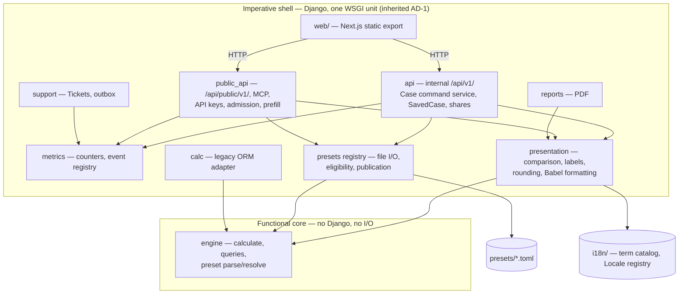
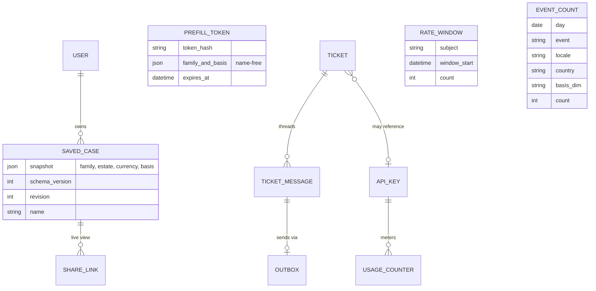

# Architecture Spine — Mawareeth Phase 2

## Design Paradigm

**Functional core, imperative shell.** A pure `engine` package turns *(family, rule set)* into values: shares as exact fractions, proof codes and refusals. It has no database, no request, no files, no language and no Django. Schools and Country presets are both **rule sets**, which are data the engine reads, never code branches.

Everything else is shell:
- loading and storing Cases and reading preset files;
- attaching labels, rounding and formatting money;
- serving the screen, PDF, internal API, public API and MCP.

Every shell renders the same shared contracts (AD-25), so no consumer computes, compares or formats shares its own way.



Arrows are allowed dependency directions; absent arrows are forbidden. In particular:
- `engine` imports nothing outside itself and the Python standard library (no Django, directly or through another package);
- `support` and `metrics` never import `engine`;
- `web` never computes fiqh, shares, rounding or formatting.

## Inherited Invariants

All of the parent spine's AD-1 to AD-14 stay binding. These are the ones that shape phase-2 work directly.

| Inherited | From parent | Binds here |
| --- | --- | --- |
| AD-1 + 2026-11-05 addendum | architecture-mawareeth-2026-09-02 | Public API, MCP, Ticket webhook, counters and timers all live in the one Django/Gunicorn image. Next.js stays a static export. A new process or container needs an AD-1 amendment. |
| AD-2 | same | One Hetzner host. No new managed service for counters, queues or tickets. |
| AD-3 | same | Cases, revisions, Tickets, outbox, API keys, counters and prefill tokens are PostgreSQL rows. Nothing durable lives in a container or a per-process cache. |
| AD-5, AD-6 | same | Snapshot and schema changes are expand → switch → contract. Every active and rollback-eligible image must preserve and correctly interpret every stored Case (AD-20). |
| AD-7 | same | Caddy is the only edge. Client IP and country are trusted only from headers Caddy rebuilds (AD-26). |
| AD-8, AD-9 | same | New endpoints add to readiness, logs and alerts; waves pass capacity gates (AD-27). |
| AD-10 | same | Presets with unchecked rules and unpublished Locales are usable only outside production. |
| AD-11 | same | No in-process threads. Deferred work (email retry, cleanup) is a durable row plus a management command on a systemd timer. Phase-2 PDFs are non-canonical drafts. |
| AD-14 | same | All phase-2 code, including API-key metering, is public AGPL-3.0 (NFR-5). |

## Invariants & Rules

### AD-15 — The engine is a pure, Django-free core [ADOPTED]

- **Binds:** FR-1 to FR-6, FR-14, FR-16, FR-17, FR-21, FR-38, FR-43, NFR-2, NFR-3; `engine`, `calc`, `api`, `public_api`, `reports`
- **Prevents:** The ORM-bound path staying the API path (`Calculation.compute` locks and writes rows; `api/preview.py` writes and rolls back temporary rows). Also prevents a second engine for Country law.
- **Rule:**
  - **Interface.** `engine/` exposes pure functions over immutable value objects (AD-25):
    - `calculate(family, rule_set) -> Result`;
    - the AD-16 queries;
    - `parse_preset(data) -> RuleSet`.
  - **Purity.** It does no I/O (files included), holds no global mutable state and reads no clock. It never imports Django or any translation function, directly or through another package. A CI import-graph check enforces this.
  - **Output.** Codes, `Fraction`s and integer minor-unit amounts only; no display text.
  - **Adapters.** `Calculation.compute` and the preview become thin adapters onto the core. Successive deaths (`manasikhat`) are composed inside the core.
  - **Switch gate.** No consumer switches to the core until the existing known-answer, School, proof, refusal and later-death corpus passes on core, adapters and presentation alike.

### AD-16 — The engine is the only place that knows fiqh

- **Binds:** FR-1, FR-2, FR-3, FR-4, FR-6, FR-14, FR-21; `api/heir_rules.py`, `calc/schools.py`, Heir `get_quote()` methods
- **Prevents:** Buttons, tree drops, refusals and shares disagreeing under a Country preset. Today `api/heir_rules.py` re-implements School blocking.
- **Rule:**
  - These answers come only from `engine` queries that take a rule set:
    - which relationships can be added where;
    - whether a drop or edit is impossible;
    - what a delete cascades to (the FR-3 impact list);
    - which facts the rule set still needs, such as the Lebanon sect question (FR-21);
    - which refusals apply, with reason codes;
    - which live Country presets would change this family's shares (FR-14);
    - the shares themselves.
  - The Case limits (50 Heirs, two later deaths) are enforced in the shell's Case command service (AD-20), not in the browser.
  - No shell module and no browser code decides any of these from its own tables.

### AD-17 — Schools and Country presets are one rule-set shape; preset versions are immutable files

- **Binds:** FR-14 to FR-22, FR-25; `presets/`, `engine`, presets registry
- **Prevents:** A preset becoming a code branch, an old Case losing its rules, per-preset schema drift, and an unchecked preset being executed through any door.
- **Rule:**
  - **Rule sets.** A rule set is a School plus settings, and each School is a built-in rule set.
  - **Preset files.** A Country preset is `presets/<iso2>/<YYYY-MM-DD>.toml`. It holds:
    - `id`, `version` (effective date) and `default_school`;
    - every addendum §A setting and every addendum §E rule;
    - `default_currency`;
    - a `citations` map from each rule key to `{statute_id, article, checked_on}`, where a rule left to the default School cites `gap_school: <school>` instead;
    - `reviewed_by` / `reviewed_on`, both null meaning Beta.
  - **No display text** in preset files (AD-21).
  - **Immutability.** A merged version file is never edited or deleted; a rule change is a new file. The one permitted edit is the paired `reviewed_by` / `reviewed_on` fields, which change no number. CI enforces this against the merge base, and git history is the review audit.
  - **Loading.** `engine.parse_preset` turns parsed data into one resolved, immutable `RuleSet` with all defaults applied. The shell **presets registry** does the file discovery.
  - **Eligibility.** The registry is the only authority on eligibility, for listing *and* for execution in every consumer (UI, internal API, public API, MCP, restore, prefill, saved Cases). A version runs in production only if every rule is cited and checked and no listed blocker for it is open. A pinned historical version that was once eligible always resolves. The **current** version of a country is the newest eligible version whose effective date is not in the future.
  - **Tests.** Each preset ships with its known-answer tests (FR-16, FR-17).

### AD-18 — Every calculation travels with a discriminated Basis; results are never stored

- **Binds:** FR-9, FR-10, FR-14, FR-15, FR-19, FR-41, NFR-2; session Case, SavedCase, ShareLink, PDF, prefill token, API/MCP response
- **Prevents:** Two consumers computing one Case under different rules, a silent recalculation after a preset update, and malformed input quietly becoming "compare".
- **Rule:**
  - **Basis shape.** The Basis is exactly one of:
    - `{kind:"compare"}`;
    - `{kind:"school", school}`;
    - `{kind:"country", preset_id, preset_version}`.
    Any other combination is a typed error. A country Basis's School is always derived from the preset, never stored.
  - **One resolver.** A single shared resolver validates and resolves a Basis for every consumer.
  - **Legacy fallback.** Only a legacy snapshot with *no* `basis` falls back. It derives from its legacy `madhab`: a valid School gives `school`, and otherwise `compare`. Malformed current input and an unavailable pinned version return typed errors, never a substituted Basis.
  - **Results are never persisted as truth.** They are recomputed from inputs plus Basis every time.
  - **Pinned versions.** A country Basis keeps its `preset_version` until the user explicitly switches. When a newer current version exists, the Case and its share links show the pinned version and offer the switch (FR-19).
  - **Share links are a live view of their SavedCase.** They show its current family and Basis, and its pinned version changes only by the owner's explicit action.
  - **No engine version stamp.** The known-answer corpus guards engine changes, and a result change from engine code ships only as a deliberate, tested correction.

### AD-19 — One presentation contract, rendered identically everywhere

- **Binds:** FR-10 to FR-14, FR-18, FR-20, FR-23 to FR-26, FR-28, FR-29, FR-38, FR-40, NFR-1, NFR-2
- **Prevents:** The Share preview, Full results, PDF, internal API, public API and MCP each comparing, rounding, labelling or selecting notices their own way.
- **Rule:**
  - **One function.** `presentation.present(outcome, basis, locale, currency)` is the only producer of the versioned `PresentedResult` (AD-25), and every consumer renders it without adding meaning.
  - **Comparison.** It runs each School for a `compare` Basis and builds the comparison envelope: agreement means identical per-person shares *and* statuses; difference lists the persons affected; a selection-required state appears when Schools differ; partial refusals are explicit.
  - **Text.** It attaches catalog labels, emitting each relationship as a translated segment plus an Arabic-original segment with language and direction metadata (FR-28). Names, fractions and amounts are bidi-isolated.
  - **Notices.** It selects the disclaimer (always), the Country notice, the civil-law notice (School Basis, every Locale), the Beta states, the FR-14 prompt and statute citations. None is dismissible except the FR-14 prompt, whose dismissal is Case state (AD-20).
  - **Money.**
    - Currency is a persisted Case input `{code, explicit}`. Its default comes from the Country preset, otherwise from the Locale, and it is re-defaulted only while `explicit` is false.
    - The estate is integer minor units validated against the currency's precision (Babel `get_currency_precision`).
    - Each allocation, Obligatory bequest included, is rounded half-up to the minor unit. A signed **rounding** line makes the amounts sum to the estate. It is kept separate from any legal unallocated or treasury share.
    - Fractions are never rounded (FR-13).
  - **Formatting.** Formatting happens once, on the server, with Babel, passing `numbering_system` from the Locale registry explicitly. The browser and PDF show the server's strings, and the browser no longer formats amounts with `Intl`.

### AD-20 — The server owns the Case; one command service, one revision

- **Binds:** FR-1 to FR-5, FR-7 to FR-9, FR-14, FR-15, FR-23; `api`, the Next.js Interview
- **Prevents:** Two working copies diverging, concurrent tabs or a stale Undo overwriting newer state, Basis and family coming from different revisions, and blue-green handover losing Cases.
- **Rule:**
  - **Ownership.** A Case's inputs live only on the server: family, estate, currency, Basis, eligibility answers and FR-14 prompt dismissal.
    - **Guest Case:** in the session, expiring 24 hours after its last change. Expiry is enforced on every read and edit, and an expired Case returns no family.
    - **Opened SavedCase:** the session holds a working copy linked to the SavedCase id and its base revision. Save writes back with a compare-and-swap on that revision, and a conflict is reported, never overwritten.
  - **Command service.** Every input mutation goes through one Case command service: add, bulk add, tree drop, edit, delete with cascade, Basis, currency, answers, restore and redeem (AD-22). Each takes the expected revision and applies atomically. On success it bumps one monotonic revision and returns the whole Case with the new revision. On a mismatch it returns a conflict carrying the current Case.
  - **Previews.** Preview responses carry the revision they were computed for, and the browser discards results for any older revision.
  - **Undo.** Undo is multi-step and page-only. The browser keeps a stack of prior Case snapshots for the visit, and each Undo is a `restore` command against the current revision. The stack is lost on reload. Stable person ids survive restore, so focus can return to the restored node.
  - **Offline.** While offline, edits are blocked and the family stays visible. There is no client edit queue.
  - **Conversion (expand → switch → contract).**
    1. Release N makes every reader accept snapshot schema 1 and 2 and still writes 1. "Every reader" means session, SavedCase list and load, share, invite and received views.
    2. Release N+1 writes 2 and backfills SavedCases and their default names (FR-8, FR-9). Live guest sessions convert on read.
    3. Country-Basis writes are enabled only when every active and rollback-eligible image reads schema 2.
    4. Schema-1 readers are removed only by AD-6 eligibility, never by release count.
  - **Proof.** A reader/writer round-trip matrix across active and rollback images is a release gate.

### AD-21 — Text has one owner per kind; Locales are registered once

- **Binds:** FR-25 to FR-30, FR-32, FR-33, FR-39; `i18n/`, `locale/`, `web/src/i18n/`, `reports/`
- **Prevents:** One fiqh term translated two ways, editing an immutable preset to add a Locale, and Django, Next.js and the PDF disagreeing on Locales, digits or fonts.
- **Rule:**
  - **Fiqh term catalog.** `i18n/terms/<locale>.json`, keyed by stable code, holds relationships, Schools, Basis kinds, `preset.<id>.name` and `preset.<id>.notice`, refusal reasons and proof templates. Each value is `{text, review}`. Proof templates use typed named placeholders, and the Arabic original is referenced by code, never copied.
  - **Locale registry.** `i18n/locales.json` gives each Locale its code, direction, Babel locale, `numbering_system`, own-script name, PDF font stack, publication state and review state (the FR-29 Beta label). Django `LANGUAGES`, Next.js `locales` and direction, the PDF, `hreflang` and the sitemap all derive from it.
  - **General UI copy** stays in `messages.ts` (Next.js) and `.po` (emails, PDF chrome, server pages).
  - **One validator and generator.** It checks schema, placeholder parity, and missing or empty keys for every registered Locale across catalog, `messages.ts` and `.po`. It generates the typed Next.js module. CI fails on any gap.
  - **Publication.** A Locale is published in production only when the validator passes and the CI PDF glyph check passes for its font stack.

### AD-22 — The public API and MCP are a separate, versioned contract inside the monolith

- **Binds:** FR-38 to FR-43, NFR-3, NFR-4; `public_api`
- **Prevents:** Internal `/api/v1/` changes breaking assistants, MCP drifting from the API, a second process outside AD-1, and Case data or names being kept.
- **Rule:**
  - **Contract.** The public API lives at `/api/public/v1/`, with no login and an optional API key, and changes only by a new version path.
  - **No stored state.** It calls the core in memory through `presentation` (AD-19). It never touches the session or creates Case rows. Its only writes are admission counters (AD-23) and prefill tokens. Names are never persisted or logged.
  - **Input errors.** Unknown or ambiguous relationship codes return a typed error listing the candidate codes.
  - **MCP.**
    - It is a stateless Streamable-HTTP endpoint with JSON responses, implemented as a Django view, targeting MCP protocol revision **2026-07-28**.
    - It validates `Origin` and the `MCP-Protocol-Version`, `Mcp-Method` and `Mcp-Name` headers, and answers 405 to GET and DELETE.
    - Its tools (`calculate_inheritance`, `list_relationships`, `list_bases`) call the same functions as the public API and return fractions as both text and numbers, the disclaimer and the Case link.
    - CI runs the official MCP Python SDK client against it.
    - Acceptance by hosted Claude and ChatGPT connectors is a manual wave-4 gate.
  - **OpenAPI.** It is generated from the same registry and catalog, and CI fails if its relationship, School or live-preset lists differ from the engine and registry (FR-39).
  - **Prefill (FR-41).**
    - It stores a name-free canonical family plus Basis behind a random 256-bit token, kept hashed.
    - Opening the link shows a confirm page. Only an explicit POST redeems it, so link prefetchers and crawlers don't consume it.
    - Redemption is one Case command: claim the unexpired token, create a new guest Case, delete the payload, all atomically. A second redemption gets "already used". It never replaces an existing unsaved Case without asking.
    - Unredeemed tokens expire after 7 days.

### AD-23 — Admission, usage and events are shared PostgreSQL counters

- **Binds:** FR-42, FR-43, FR-44, NFR-4, SM-1 to SM-6; `metrics`, `public_api`, DRF throttles
- **Prevents:** Per-process limits that multiply by workers and slots and reset on deploy (today no `CACHES` is set), double billing of MCP calls, credential records in two places, and event data becoming personal tracking.
- **Rule:**
  - **Keys.** `public_api` alone owns API keys: issue, quota, revoke and hash. Issuance is admin-only. A Ticket may reference a key, never hold one.
  - **Admission.** One admission service atomically checks and consumes one unit per external invocation before any engine work.
    - API and MCP share the same bucket.
    - A valid key uses its quota; no key, or a revoked or invalid key, uses the per-IP free limit.
    - Billable usage counts admitted requests that returned a result or a refusal; validation errors don't count.
    - Months are UTC calendar months.
    - If the counter store fails, admission fails closed with 503.
    - Over-limit responses carry `Retry-After` and the API-access Ticket route.
  - **Throttles.** Existing DRF throttles move to the same shared store.
  - **Event registry.** `metrics/events.py` defines each event's trigger, allowed dimensions and dedup scope. Dimensions are day, event, Locale, country, and Basis kind or preset id where relevant. "Once per Case" events are deduplicated by markers in Case state, never by analytics ids. Aggregate rows never hold an IP, user, session, key or Case id. Abuse windows and per-key billing rows are separate tables with their own retention.
  - **Cleanup.** Expiry is done by management commands on systemd timers. It covers windows, prefill tokens, guest sessions, delivered outbox rows, and closed Tickets older than 12 months.

### AD-24 — Support Tickets live in the app, with an email outbox through Brevo

- **Binds:** FR-34 to FR-37, FR-43, NFR-4, SM-5; `support`
- **Prevents:** Ticket data spreading to a new vendor or service, acknowledgements for Tickets that never committed, lost or duplicated replies, replies attaching to the wrong Ticket, and Case data leaking into support.
- **Rule:**
  - **Storage.** A Ticket and its messages are PostgreSQL rows, worked in the Django admin. A Ticket stores its Locale, its first-reply time and only what the visitor typed, plus an optional Case link they chose to give. Case data is never copied in automatically.
  - **Spam.** The contact form uses tracking-free controls: a honeypot, a time check and per-IP admission (AD-23).
  - **Outbound mail.** Each message is written to an **outbox** row in the same transaction as the Ticket change. A bounded send to Brevo SMTP is tried after commit, and failures are retried by a timer command. The first-reply time is set when the owner's first reply is successfully sent.
  - **Inbound mail.**
    - Each Ticket has a reply-to address `t-<token>@reply.<domain>`.
    - Brevo's inbound-parse webhook is authenticated by a secret in the URL path, compared in constant time and rotatable.
    - The Ticket is read from the `Recipients` field, never from the subject or threading headers.
    - The webhook stores the message and its `MessageId` dedupe key atomically before acknowledging.
  - **Retention.** Closed Tickets are deleted 12 months after closing, and on request within 30 days.

### AD-25 — Shared domain contracts are versioned schemas built first

- **Binds:** all phase-2 epics; `engine`, `api`, `presentation`, `public_api`, `presets`, `i18n`
- **Prevents:** Epics each inventing their own family graph, Result, comparison or presented shape, and a wave-ordering cycle where wave 1 and wave 2 both build the foundations.
- **Rule:**
  - **The contracts.** These are versioned, committed schemas with lossless round-trip fixtures:
    - **Family:** stable person ids; lineage edges; root-relative relationship codes; status of alive, died before or with the Deceased, or died later (with order); eligibility answers such as sect or religion; lifetime gifts and voluntary bequests per branch; estate and currency.
    - **Basis** (AD-18).
    - **Result:** per stable person id, allocation kind (fixed, residue, bequest, blocked, refused), exact fraction with its stage base, proof steps with typed parameters and rule and citation keys, and later-death layers.
    - **Comparison envelope** (AD-19).
    - **PresentedResult.**
    - **Preset and catalog schemas** (AD-17, AD-21).
  - **Ownership.** The wave-1 **foundation epic** owns these schemas and delivers:
    - the pure School engine with full corpus parity;
    - the Case command service with revisions;
    - presentation;
    - the i18n validator.
  - **Order.** The foundation ships first with unchanged School behaviour. Wave-1 features consume it. Later waves extend the published contracts additively and switch on presets and Locales only through their registry gates.
  - **Changes.** A change that alters meaning is a contract version bump with fixtures across every consumer.

### AD-26 — Public surfaces have one security and resource envelope

- **Binds:** `/api/public/v1/`, MCP, contact form, prefill, inbound webhook, FR-44 country
- **Prevents:** Spoofable quotas, unbounded work or storage exhausting the sole host, and each endpoint inventing its own protection.
- **Rule:**
  - **Trusted headers.** Client IP and country come only from headers Caddy strips and rebuilds. `CF-IPCountry` is trusted only when the origin is reachable solely through Cloudflare. Otherwise, and for `XX`, `T1` or any invalid value, the country is `unknown`. Country values are validated against ISO 3166-1.
  - **Bounds before work.** Body size, Heirs (50), later deaths (2), graph depth and MCP batch size are bounded. Admission (AD-23) runs before parsing into the engine. Each calculation request has an execution budget well inside the inherited 120 s bound.
  - **Cross-site and webhook.** Session endpoints keep CSRF. Public API and MCP endpoints are CSRF-exempt but never read the session cookie. The webhook takes no cookies.
  - **Logging.** Logs never contain request bodies, names, family data, API keys, reply tokens or prefill URLs.

### AD-27 — Budgets, observability and recovery are release gates

- **Binds:** NFR-3, FR-43, waves 1 to 4; all new endpoints and timers
- **Prevents:** Generic readiness staying green while a new capability fails or starves the monolith, and a restore resurrecting revoked or deleted data.
- **Rule:**
  - **Budgets.** These are acceptance gates measured with both slots running before the wave that introduces them ships:
    - engine under 200 ms for a standard family;
    - Share preview p95 under 1 s end to end for 50 Heirs on a mid-range phone over 4G;
    - public API p95 under 1 s;
    - lock waits bounded inside those budgets.
  - **Observability.** Each new endpoint and timer emits redacted structured outcomes and low-cardinality latency, error and limit counts. A timer failure, outbox backlog or webhook rejection spike alerts the AD-8 operator.
  - **Recovery.** The restore runbook gains checks for the new tables. After a restore it reapplies Ticket deletions and API-key revocations. The matching release's preset and catalog files must be present.
  - **Drafts.** Phase-2 PDFs are non-canonical drafts, regenerated from current inputs. A canonical artifact still needs the inherited AD-11 decision.

## Consistency Conventions

| Concern | Convention |
| --- | --- |
| Codes | Relationship, School, refusal, proof, event and statute ids: stable lowercase snake_case, never renamed or reused; labels only from the catalog |
| Preset identity | `preset_id` = ISO 3166-1 alpha-2 lowercase; `preset_version` = effective date `YYYY-MM-DD` |
| Person identity | Stable opaque id per person within a Case, kept through edits, restore, save and share |
| Revision | One monotonic integer per Case; every mutating request sends `expected_revision` |
| Fractions | `{numerator, denominator}` integers, reduced, with the stage base named; never floats |
| Money | `{amount_minor: int, currency: ISO 4217}` plus a server-formatted string; rounding half-up per allocation |
| Locale and country | Locale = registry code; country = ISO 3166-1 alpha-2 or `unknown` |
| Errors and refusals | Refusal `{status:"refused", reason}` with no shares; input error `{error: code, detail, candidates?}`; conflict `{error:"conflict", case}` |
| Time | UTC in storage and in billing months; Locale formatting only at presentation |
| Deferred work | Durable row + `manage.py` command + systemd timer; never a thread |
| State mutation | Cases through the command service only; schema via Django ORM and committed migrations (inherited); presets and catalogs via git commits with tests |

## Stack

These are the versions pinned in the repo at authoring time. Patch upgrades belong to the code. TypeScript stays on the 5.x line on purpose.

| Name | Version |
| --- | --- |
| Python | 3.12 (`>=3.12,<3.13`) |
| Django | 5.2.17 (LTS to 2028-04; 5.2.19 available) |
| Django REST framework | 3.18.3 |
| django-polymorphic | 4.1.0 (legacy `calc` models only) |
| WeasyPrint | 70.0 |
| Babel | 2.18.0 |
| MCP protocol revision | 2026-07-28 |
| MCP Python SDK | 2.3.0 (CI test client only) |
| Next.js | 16.4.5 (static export; 16.4.6 available) |
| React | 19.3.0 |
| TypeScript | 5.9.3 |
| PostgreSQL | 17.11 (inherited; 17.12 available) |
| PDF fonts | Noto core + Noto CJK + an Urdu Nastaliq face, selected per Locale |
| Email | Brevo SMTP + inbound-parse webhook |

## Structural Seed

```text
engine/            # pure core: value objects, calculate, queries, parse_preset — no Django, no I/O
presets/           # <iso2>/<YYYY-MM-DD>.toml, schema, known-answer tests; registry module in the shell
i18n/              # terms/<locale>.json, locales.json, validator + Next.js codegen
calc/              # legacy ORM models; compute() becomes an adapter onto engine
api/               # internal /api/v1/ — Case command service, revisions, SavedCase, shares, restore
presentation/      # present(): comparison envelope, labels, notices, rounding, Babel
public_api/        # /api/public/v1/, OpenAPI, MCP view, API keys, admission, prefill
support/           # Tickets, outbox, Brevo inbound webhook
metrics/           # counters, event registry, aggregates admin view
reports/           # PDF from PresentedResult, per-Locale font stacks
web/               # Next.js static export
```



## Capability → Architecture Map

| Capability / Area | Lives in | Governed by |
| --- | --- | --- |
| Foundation: contracts, pure engine, command service, presentation, i18n validator | `engine`, `api`, `presentation`, `i18n` | AD-25, AD-15, AD-20, AD-19, AD-21 |
| FR-1 to FR-6 family entry, tree, Undo | `api`, `web`, `engine` | AD-16, AD-20, AD-25 |
| FR-7 to FR-9 named Saved cases, conversion | `api` | AD-18, AD-20 |
| FR-10 to FR-13 results clarity, rounding | `presentation`, `web`, `reports` | AD-19 |
| FR-14 to FR-22 Country law | `engine`, `presets` | AD-15 to AD-18 |
| FR-23 to FR-26 currency, formats, notices | `presentation`, `i18n` | AD-19, AD-21 |
| FR-27 to FR-30 Locales | `i18n`, `locale/`, `web`, `reports` | AD-21 |
| FR-31 to FR-33 content review, legal pages | `i18n`, `locale/`, legal pages | AD-21 |
| FR-34 to FR-37 support, WhatsApp link | `support`, `web` | AD-24, AD-23, AD-26 |
| FR-38 to FR-43 API, MCP, keys, prefill | `public_api`, `metrics` | AD-22, AD-23, AD-26, AD-19 |
| FR-44 event counts | `metrics` | AD-23 |
| FR-45 moderated test protocol | docs (no code) | — |
| NFR-3 budgets, operations | all new endpoints | AD-27 |

## Deferred

- **Ja'fari school, Lebanese Shia and non-Muslim rules.** The PRD defers them. AD-17's rule-set shape must hold, but they aren't designed now.
- **Engine version stamp.** Revisit if a correction ever needs a user-visible "the calculation changed" notice, or before any canonical artifact (AD-27).
- **Undo history across reloads or devices.** It would need server-kept snapshots and a retention rule.
- **Offline edit queue.** Edits are blocked offline (AD-20).
- **Redis or another shared cache.** Revisit only if PostgreSQL counters measurably break the AD-27 budgets.
- **Separate MCP process or an ASGI switch.** Revisit if stateless MCP stops covering what hosted assistants need. Either needs an AD-1 amendment.
- **In-app billing.** Phase 2 invoices manually from usage (FR-43).
- **Guest Cases kept in the browser before save.** Deferred by the PRD §6.2.
- **Retiring the legacy server-rendered results pages and the Google Analytics tag.** Decide in the wave-1 content and legal stories. Until then they must not compute or format shares outside AD-19.
- **Preset research blockers** (Jordan numbering, UAE articles, Algeria daughters' line, Egypt art. 76 limits, Lebanon Council decisions). These are data, gated by the AD-17 registry.
- **Owner configuration.** WhatsApp number type, Locale order within waves, API pricing and free-limit values.
